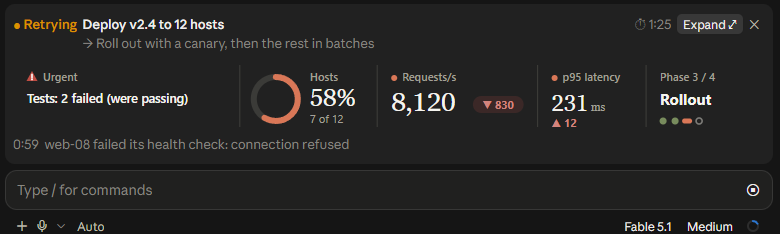
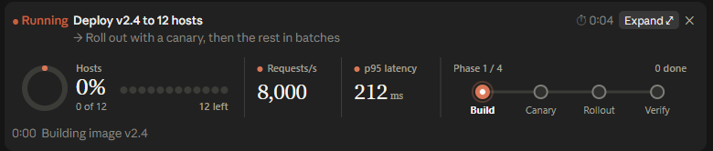
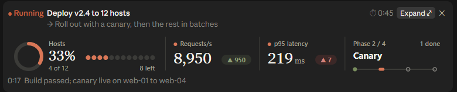
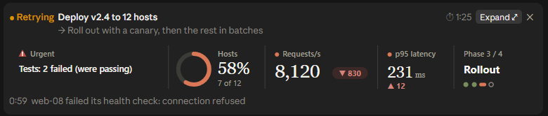
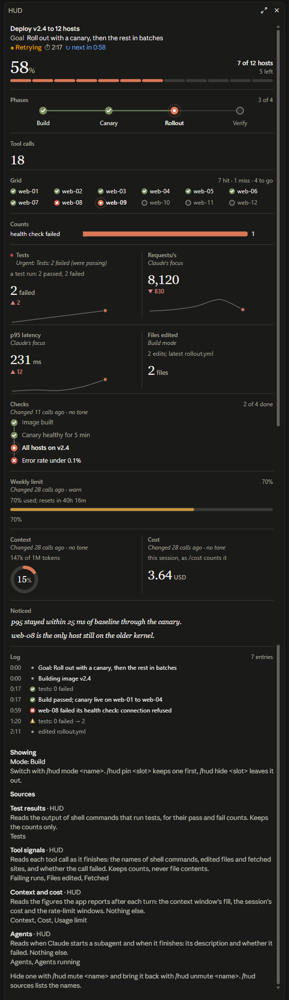
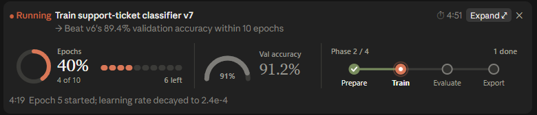
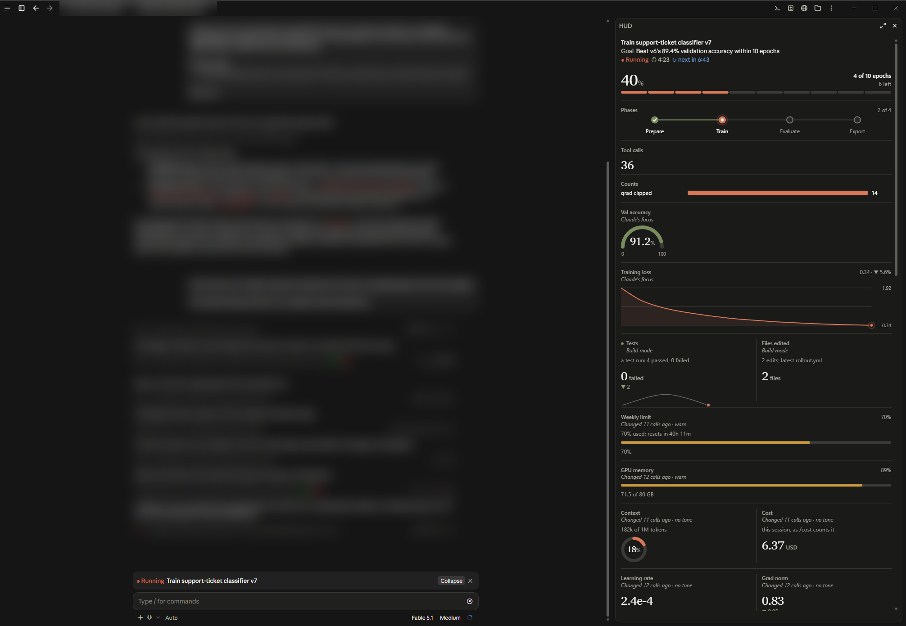
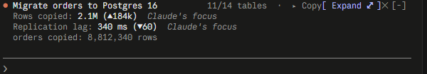

# HUD for Claude Code

A live progress strip above the prompt, and a dashboard beside the conversation, for the long tasks Claude Code
works on. It runs in the Claude Desktop app's Code tab and in the terminal.



While Claude builds, migrates, refactors or retries, the strip shows the run's title and goal, its progress, the
figures that matter and the last thing that happened. **Expand** opens the full dashboard. You don't have to ask for
it: the HUD reads Claude's tool calls for what it can see on its own, starts a run when a message turns into a long
task, and keeps the board honest while Claude works. Claude adds only what it alone knows: the title, the goal, the
phases, and done or failed.

## Install

In Claude Code:

```
/plugin install hud --marketplace kyledarling-io/claude-code-desktop-hud
```

In the Claude Desktop app: **Customize → Plugins → Add → Add marketplace → Add from a repository**, paste
`https://github.com/kyledarling-io/claude-code-desktop-hud`, sync, then install **hud** from the marketplace. Start a
Code session and the strip appears when Claude starts a long task, or say "show me a HUD while you do this."

Needs Claude Code 2.1.295 or later. VS Code and the mobile app don't draw the strip yet.

## A run, start to finish

A rollout to twelve hosts where one fails its health check.

| | |
| --- | --- |
|  | **Start.** Claude names the run, its goal and its phases. Progress, figures and the phase rail take the strip. |
|  | **Mid-run.** Figures carry a change and a sparkline, green or red once Claude says which way is good. |
|  | **Something breaks.** Tests that were passing now fail. The HUD saw it in the test runner's own output and put it first, ahead of everything Claude sent. |



The dashboard shows everything on the board. Under each figure is a line saying why it is there: `Urgent`,
`Claude's focus`, `Build mode`, `Changed 2 calls ago · warn`, or the name of the plugin that sent it. At the bottom,
**Showing** names your mode, pins and hides, and **Sources** lists every plugin feeding the board and what each one
reads.

## What it does on its own

- **Starts itself.** When a turn becomes a long task (eight tool calls, or a minute) and no run is going, a run starts,
  titled from your message, dim until Claude names it. Only where someone is watching, and never from a subagent.
- **Reads the work.** Tests failing, files edited, commands failing in a row, sites fetched, subagents at work,
  context and cost. All from Claude's tool calls, none from Claude's words.
- **Writes the log.** Edits, failed commands, changes in the test count, fetches and searches land in the log as
  dim lines beside Claude's own.
- **Raises what's urgent.** Tests that were passing and now fail, the same command failing three times, the context
  window or a rate limit past 85%. The HUD's own rules raise it, so no plugin and no prompt can.
- **Holds still.** The strip changes only at a boundary (a turn's end, a phase, a rebuild), so it doesn't flicker.
  Figures that stop changing dim with their age, and leave if they stay stale.
- **Fills widgets by itself.** Claude can bind a figure to a command, a file or a site and leave it. Each matching
  call is read for one number. With nothing behind it, a widget says "no reading", never an old number.

## What Claude can show

Progress, a phase rail, figures with deltas and sparklines, a grid of hosts or files, a trend line, counts, a
countdown, a log, and gauge, ring, meter, line, bars, columns, donut, heatmap, ranked list, checklist, table and
callout. A training run with most of them in use:





## Commands

| Command | Does |
| --- | --- |
| `/hud` | Brings back a hidden strip and prints the run, with why each figure is shown |
| `/hud mode <build\|debug\|review\|research\|plan>` | Sets which figures come first. Yours outranks Claude's. |
| `/hud pin <slot>`, `/hud hide <slot>` | Keeps a figure first, or leaves it out, in this session and the next |
| `/hud sources`, `/hud mute <name>` | Lists the plugins feeding the board, or silences one |

## In the terminal

In the terminal the band above the prompt is text: the same figures, in the same order, each with why it is there.



## Sources

Any plugin can send the HUD figures of its own through `$.hud`: a deploy's state, a queue's depth, the last build.
The HUD checks what it gets, ranks it with everything else and shows the sender's name beside it. Two sources ship
here, each its own install: **hud-git** (branch, files changed, ahead and behind) and **hud-ci** (your branch's
GitHub Actions run). [SOURCES.md](SOURCES.md) is the guide to writing one, and
[examples/source-template](examples/source-template) is a working source with its test.

## What it can access

The HUD reads no files, makes no network requests, starts no processes and calls no model. It reads Claude's tool
calls for names and counts (a command's name, a file's path, the pass and fail counts a test runner prints), never
file contents, and nothing else from a command's output. Claude gets
one cached section of its system prompt and a one-line note beside your messages during a run. Nothing another
plugin sends reaches Claude. `claude plugin validate .` lists every hook it handles and every call it makes.

## Development

See [DEVELOPING.md](DEVELOPING.md). Run the tests with `claude plugin test .`.

Created by Kyle Darling. Built with Claude Code. [MIT License](LICENSE).
